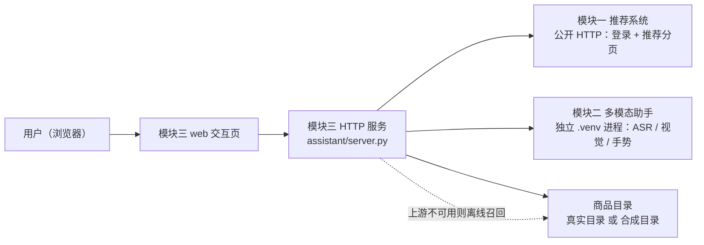
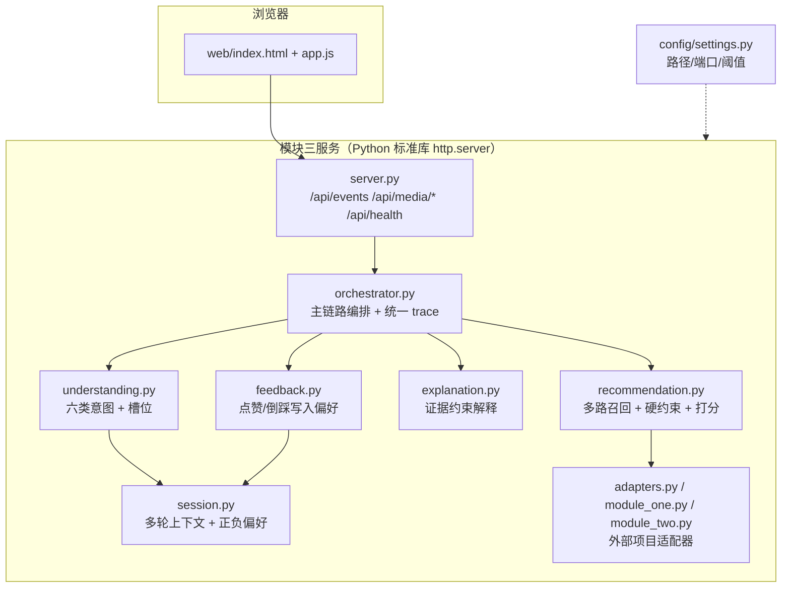
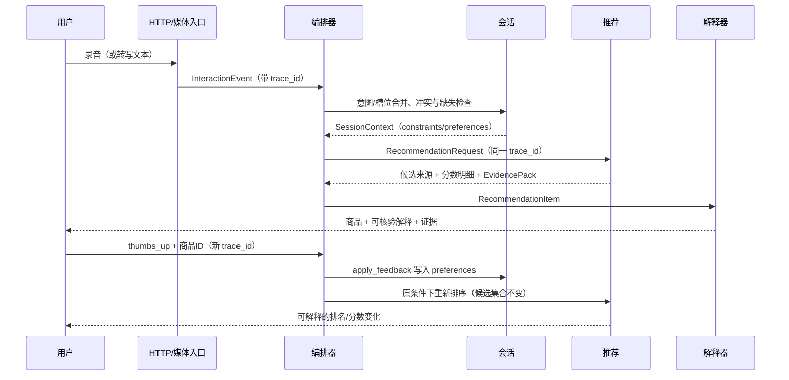

# 系统架构与接口契约

> 阶段1 提交物。回答三个问题：系统由哪些部分组成（上下文/容器图）、一次请求怎么流动（时序图）、
> 跨项目与跨模块用什么协议说话（契约表）。所有路径、端口、阈值都来自 `config/settings.py`。

## 1. 目标与边界

把「模块一 推荐系统」与「模块二 多模态助手」整合成一个可通过稳定接口协作的工程系统：
三个项目**只通过公开接口通信**，模块三不读模块一的内部变量、不读模块二的 GUI；
两边都保留离线降级（模块一不可用 → 合成目录；模块二不可用 → 手动输入）。

数据口径：`IRA_PROFILE=auto`（默认）自动接入同级模块一的 2,208 件真实商品与 Oblivionis v2 冻结排序，
价格是 **GBP 历史最后观测单价**，不是当前售价；`IRA_PROFILE=demo` 或自动接入失败回退时使用
`data/catalog.json` 的 18 件合成商品。合成样例只用于验收流程，不代表真实业务效果。

为了让任何人 clone 这个仓库就能读懂全链路，模块一、模块二的**代码副本**放在仓库
`vendor/01_recommender_system/`（冻结 Flask 服务、冻结排序结果、商品目录、模型源码）和
`vendor/02_multimodal_ai_assistant/`（ASR / 视觉 / 手势 / RAG 源码）。它们不参与模块三的 import，
只作为子进程工作目录与阅读材料；`config/settings.py::_module_root()` 优先用同级原项目、
没有则退回 `vendor/`。详见 [vendor/README.md](../vendor/README.md) 与 [代码阅读指南](代码阅读指南.md)。

## 2. 系统上下文图

## 3. 容器图

> 逐步数据流（每一步的 trace_id、主要字段与失败出口）：[数据流与失败出口](数据流与失败出口.md)。

## 4. 主链路时序（语音要礼物 → 推荐 → 点赞反馈）

失败出口：`ContractError` → 400 + 错误码，会话回滚；上游超时/不可用 → 503/504 + `degraded=true`；
硬约束空集 → `status=empty`，不放宽约束；解释缺证据 → 该条解释降级但**不编造**。

## 5. 数据结构与契约

| 结构 | 必填字段 | 关键约束 |
| --- | --- | --- |
| `InteractionEvent` | `trace_id,user_id,session_id,timestamp,source,payload` | `source∈{text,voice,vision,gesture}`；`timestamp` 必须带时区；voice 要 `transcript`，vision 要 `labels`，gesture 要 `gesture` |
| `RecommendationRequest` | 元数据 + `intent,constraints,preferences,item_ids,top_k` | 意图六选一；槽位只允许 `category/budget_min/budget_max/recipient/color/scene/currency`；`top_k∈[1,24]` |
| `EvidencePack` | `trace_id,item_id,attributes,sources,matched_constraints,visual_labels,snippets` | 解释的唯一事实来源；snippet id 必须是 `catalog:<item_id>:` 前缀 |
| `RecommendationItem` | `trace_id,item_id,name,price,category,color,sources,score,score_breakdown,evidence` | `price=null` 时 `price_kind` 必须为 `missing`；`sources` 不可为空（来源可追溯） |

统一响应字段：`trace_id,status,message,items,context,degraded,warnings,error,trace,elapsed_ms`。
`status∈{ok,empty,needs_clarification,conflict,ended,error}`；
`trace` 每项 `{trace_id,stage,elapsed_ms,data}`，阶段依次为
`event → intent → context → request → recall_and_ranking → explanation → result`（出错时为 `error`）。
**所有 trace 项的 trace_id 必须等于响应的 trace_id**，这是“可追踪”的验收点。

错误码（任何失败都必须带错误码，禁止“捕获后返回空字典”）：

| 错误码 | 触发场景 | 处理 |
| --- | --- | --- |
| `INVALID_EVENT` | 事件缺字段、类型错、非法模态 payload | 400，不进入会话 |
| `INVALID_REQUEST` / `INVALID_ITEM` | 请求或商品字段非法 | 400 |
| `INVALID_CATALOG` | 目录缺失或字段不合法 | 启动/请求失败并说明 |
| `ITEM_NOT_FOUND` | 目标商品不在目录 | 400 |
| `INVALID_FEEDBACK` | 反馈对象不在当前会话最近结果 | 400，会话回滚 |
| `INVALID_MEDIA` / `INVALID_PERCEPTION` | 媒体格式/大小/标签不合法 | 400，保留手动输入 |
| `UPSTREAM_TIMEOUT` / `UPSTREAM_UNAVAILABLE` | 模块一/模块二超时或不可用 | 503/504，离线兜底或明确失败 |
| `INVALID_UPSTREAM` | 上游响应不符合协议 | 降级并告警，不静默接受 |
| `INTERNAL_ERROR` | 未预期异常 | 500，保留 trace |

## 6. 正常样例与边界样例

| 类型 | 输入 | 预期结果 | 证据 |
| --- | --- | --- | --- |
| 正常 | 语音“给朋友买礼物，预算300元以内” | `ok`；items 满足对象/预算；每件有 explanation.citations | `outputs/stage02_context_cases.jsonl`、`stage06_acceptance.json` |
| 边界-空集 | “耳机预算1元以内” | `empty`，items=[]，message 提示调整，不放宽预算 | `outputs/stage03_demo.json` |
| 边界-追问 | similar/compare/explain/feedback 缺 item_id；预算“三百元”无法解析 | `needs_clarification`，不更新约束 | `outputs/stage02_context_cases.jsonl` |
| 边界-冲突 | 同轮颜色矛盾、预算上下界矛盾 | `conflict`，拒绝更新，保留原约束 | `outputs/stage02_context_cases.jsonl` |
| 边界-降级 | 视觉置信度 < 0.7 | 忽略标签并记录，不进入约束 | `outputs/stage02_context_cases.jsonl` |

## 7. 可复现口径

- 同一输入、同一会话初始状态、同一目录与配置下，`items` 的顺序、`item_id`、`score`、`score_breakdown`
  逐字段一致；阶段3 的“确定性复现”用例落盘两次响应并给出 sha256 摘要。
- 对比重跑时忽略 `generated_at`、`elapsed_ms` 等时间字段；`trace_id` 由调用方给定。
- 反馈对照必须固定用户、查询、候选池与 TopK（见 `outputs/stage05_feedback_ab.json` 的 `comparison_scope`）。
- 真实模型（ASR/视觉/手势）推理受硬件影响，不承诺逐字节复现；可复现承诺只针对结构化契约与离线链路。

## 8. 配置与接入

路径、端口、阈值、TTL、TopK、超时全部来自 `config/settings.py`，可用 `IRA_*` 环境变量覆盖。
兄弟项目根目录的规则是「**同级优先、否则 vendor**」：`../01_recommender_system` 存在就用原项目，
否则用 `vendor/01_recommender_system`（模块二同理），也可用 `IRA_MODULE_ONE_ROOT` / `IRA_MODULE_TWO_ROOT` 显式指定。
模块一通过 `/api/auth/login` 与 `/api/recommendations` 公开接口接入（演示账号见 `settings.py`，
仅用于本机课程演示）；模块二通过独立 `.venv` 子进程的 JSON-lines 协议接入，工作进程串行执行、
超时回收自己的进程树，识别结果先转成统一事件再进入编排。启动时不加载任何模型；
点击录音/拍照时才申请权限，媒体只在本机推理。
