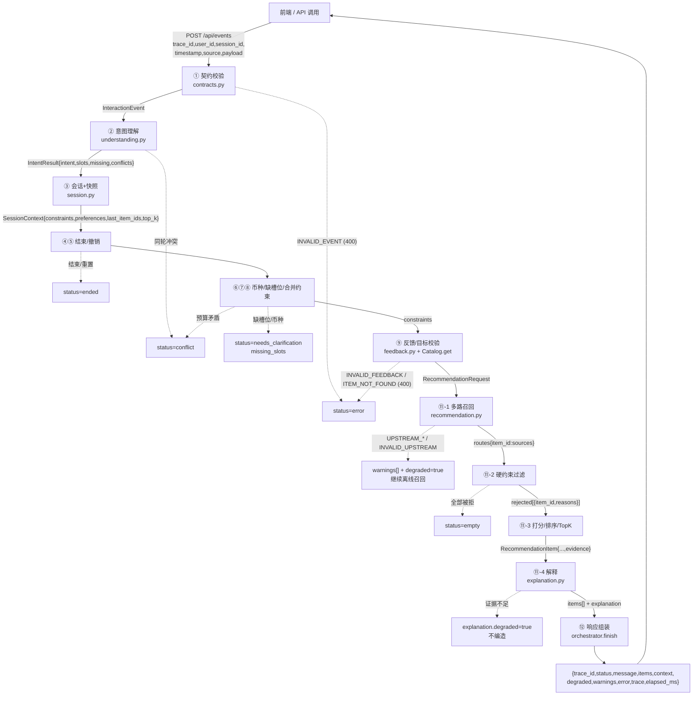

# 数据流与失败出口（任务书步骤1 第2点）

> 任务书原文：「画出或补充数据流，标明 trace_id、主要字段与失败出口。」
> 这个文件就是那份数据流：**一张图 + 两张表**（每阶段字段表、失败出口表），全部字段名和错误码都能在代码里对上。
> 讲的时候顺序：图 → trace_id 怎么贯穿 → 字段表 → 失败出口表。

---

## 1. 数据流图（ASCII 版，哪里失败标在哪里）

```text
 前端 / 外部调用
   │  POST /api/events
   │  事件字段：trace_id, user_id, session_id, timestamp, source,
   │            payload{text|transcript|labels|gesture|slots|intent|item_ids|action|top_k}
   ▼
┌──────────────────────────────────────────────────────────────────────────────────────┐
│ ① 契约校验  assistant/contracts.py::InteractionEvent.from_dict                       │
│    输出：InteractionEvent（校验通过的 6 个字段 + payload）                            │
└───────────────────────────────┬──────────────────────────────────────────────────────┘
                                │ 失败 ──────────► status=error, error.code=INVALID_EVENT（HTTP 400）
                                ▼
┌──────────────────────────────────────────────────────────────────────────────────────┐
│ ② 意图理解  assistant/understanding.py::understand                                  │
│    输出：IntentResult{intent, slots, slot_evidence, item_ids, feedback, action,      │
│                        conflicts, ignored_labels, missing, text}                     │
└───────────────────────────────┬──────────────────────────────────────────────────────┘
                                │ 同轮条件矛盾 ──► status=conflict
                                ▼
┌──────────────────────────────────────────────────────────────────────────────────────┐
│ ③ 取会话 + 存快照  assistant/session.py::SessionStore.get / ctx.snapshot            │
│    输出：SessionContext{constraints, slot_evidence, preferences, last_item_ids,      │
│                         last_intent, target_item_ids, top_k} + 快照（用于回滚）       │
└───────────────────────────────┬──────────────────────────────────────────────────────┘
                                │ 用户说结束/重置 ──► status=ended（清空会话）
                                │ 用户说撤销 ──────► 恢复上一轮 constraints（继续）
                                ▼
┌──────────────────────────────────────────────────────────────────────────────────────┐
│ ④⑤⑥⑦⑧ 拦截：币种 / 缺槽位 / 合并约束  orchestrator.py + session.py::merge          │
│    输出：合并后的 constraints（session.merge），或 missing_slots / conflicts          │
└───────────────────────────────┬──────────────────────────────────────────────────────┘
      │ 币种不符 / 缺必选槽位 ───► status=needs_clarification（missing_slots 里写明缺什么）
      │ 预算下界 > 上界 ────────► status=conflict（状态不变）
      ▼
┌──────────────────────────────────────────────────────────────────────────────────────┐
│ ⑨ 反馈 / 目标商品校验  assistant/feedback.py + Catalog.get                          │
│    输出：preferences{商品ID: +1/-1}，或 targets[商品行]                              │
└───────────────────────────────┬──────────────────────────────────────────────────────┘
      │ 反馈目标不在最近展示里 ──► status=error, error.code=INVALID_FEEDBACK（HTTP 400）
      │ 点名商品不在目录里 ─────► status=error, error.code=ITEM_NOT_FOUND（HTTP 400）
      ▼
┌──────────────────────────────────────────────────────────────────────────────────────┐
│ ⑩ 组装请求  contracts.py::RecommendationRequest                                      │
│    字段：trace_id, user_id, session_id, timestamp, source, intent, constraints,      │
│          preferences, item_ids, top_k                                               │
└───────────────────────────────┬──────────────────────────────────────────────────────┘
                                ▼
┌──────────────────────────────────────────────────────────────────────────────────────┐
│ ⑪-1 多路召回  recommendation.py::_recall_upstream + routes                          │
│    输出：upstream{item_id: 分数}、warnings[]、mode('hybrid'|'offline_demo')、        │
│          routes{item_id: {popularity|category|context_tags|similarity|module_one_http}}│
└───────────────────────────────┬──────────────────────────────────────────────────────┘
      │ 上游超时/不可用/ID 不匹配 ──► 不报错：warnings[].code（UPSTREAM_TIMEOUT /
      │                              INVALID_UPSTREAM / UPSTREAM_UNAVAILABLE）+ degraded=true
      ▼
┌──────────────────────────────────────────────────────────────────────────────────────┐
│ ⑪-2 硬约束过滤  recommendation.py::_hard_failures                                   │
│    输出：rejected[{item_id, reasons[category|color|budget|missing_price]}]           │
└───────────────────────────────┬──────────────────────────────────────────────────────┘
      │ 全部被拒（空集）───────► 继续走完，最终 status=empty（不放宽条件）
      ▼
┌──────────────────────────────────────────────────────────────────────────────────────┐
│ ⑪-3 打分 / 排序 / TopK  recommendation.py::_score_breakdown + recommend             │
│    输出：RecommendationItem{trace_id, item_id, name, price, category, color,         │
│          sources[], score, score_breakdown{6 项}, evidence, explanation, currency,   │
│          price_kind}，按 (-score, item_id) 排序取 top_k                              │
└───────────────────────────────┬──────────────────────────────────────────────────────┘
                                ▼
┌──────────────────────────────────────────────────────────────────────────────────────┐
│ ⑪-4 证据解释  assistant/explanation.py::explain                                     │
│    输出：explanation{text, speech_text, citations[], degraded, code}                 │
└───────────────────────────────┬──────────────────────────────────────────────────────┘
      │ 证据缺失/属性不一致 ────► 该条 explanation.degraded=true（不编造；不中断整个请求）
      ▼
┌──────────────────────────────────────────────────────────────────────────────────────┐
│ ⑫ 响应组装  orchestrator.py::finish                                                 │
│    trace_id, status, message, items[], context, degraded, warnings[], error,         │
│    trace[], elapsed_ms（可选 missing_slots / conflicts / mode / dataset / currency / │
│    price_notice）                                                                    │
└──────────────────────────────────────────────────────────────────────────────────────┘
                                │
                                ▼
                          前端渲染 / 调用方消费
```

**一句话总结**：硬失败（400）只在 ①（事件）、⑨（反馈/目标）出现；条件类失败用 `needs_clarification`/`conflict`/`empty` 表达；上游失败一律降级（`warnings` + `degraded`），不打断请求。

---

## 2. 数据流图（Mermaid 版，GitHub 上会自动渲染）



---

## 3. trace_id 怎么贯穿（验收点“可追踪”）

一次请求从进来到出去，**同一个 trace_id 会出现在三个地方**，全部相等：

1. 响应顶层：`response.trace_id`
2. 流水账每条：`response.trace[i].trace_id`
3. 每件商品：`response.items[j].trace_id`（证据包 `items[j].evidence.trace_id` 也一样）

`trace` 固定 7 段，顺序固定：

```text
event → intent → context → request → recall_and_ranking → explanation → result
（出错时最后一段是 error）
```

每段的结构固定 4 个字段：

```json
{"trace_id": "orchestrator-normal", "stage": "recall_and_ranking", "elapsed_ms": 0.291, "data": {…}}
```

- `stage`：阶段名（上面 7 个 + error）；
- `elapsed_ms`：相对本次请求开始的毫秒数；
- `data`：这个阶段当时的真实数据（事件、意图、请求、召回诊断、解释列表）。

**实测**（`outputs/stage03_demo.json` 的 `cases[0]`，trace_id = `orchestrator-normal`）：
7 段 stage 全部按顺序出现；`all(trace[i].trace_id == response.trace_id) == True`；
`all(items[j].trace_id == response.trace_id) == True`。

---

## 4. 每个阶段的主要字段（表）

| 阶段 | 这一步的输入 | 这一步的输出（主要字段） | 谁产生 |
| --- | --- | --- | --- |
| ① 契约校验 | 原始事件 dict | `InteractionEvent{trace_id, user_id, session_id, timestamp, source, payload}` | 成员1 contracts.py |
| ② 意图理解 | InteractionEvent | `IntentResult{intent, slots, slot_evidence, item_ids, feedback, action, conflicts, ignored_labels, missing, text}` | 成员2 understanding.py |
| ③ 会话快照 | user_id + session_id | `SessionContext{constraints, slot_evidence, preferences, last_item_ids, last_intent, target_item_ids, top_k}` + `snapshot` | 成员2 session.py |
| ④⑤ 动作 | `intent.action` | `end/reset` → 会话被删；`undo` → 恢复上一轮约束 | 成员3 orchestrator |
| ⑥⑦⑧ 拦截 | `intent.conflicts/missing/slots` + 目录币种 | `conflicts[]` 或 `missing_slots[]` 或合并后的 `constraints` | 成员3 orchestrator |
| ⑨ 反馈/目标 | `intent.item_ids/feedback` | `preferences{商品ID:±1}` 或 `targets[商品行]` | 成员5 feedback.py + 成员3 Catalog |
| ⑩ 请求 | 会话状态 + 意图 | `RecommendationRequest{trace_id,user_id,session_id,timestamp,source,intent,constraints,preferences,item_ids,top_k}` | 成员3 orchestrator |
| ⑪-1 召回 | RecommendationRequest | `upstream{item_id:分数}`、`warnings[{code,message}]`、`mode`、`routes{item_id: set(sources)}` | 成员3 recommendation.py |
| ⑪-2 过滤 | routes + constraints | `rejected[{item_id, reasons[]}]`、通过的候选 | 成员3 recommendation.py |
| ⑪-3 打分排序 | 候选商品行 | `RecommendationItem{trace_id,item_id,name,price,category,color,sources[],score,score_breakdown{6},evidence,currency,price_kind}` | 成员3 recommendation.py |
| ⑪-4 解释 | RecommendationItem | `explanation{text, speech_text, citations[], degraded, code}` | 成员4 explanation.py |
| ⑫ 响应 | 上面所有结果 | `{trace_id,status,message,items[],context,degraded,warnings[],error,trace[],elapsed_ms}` + 可选字段 | 成员3 orchestrator |

### 证据包（EvidencePack）字段

`evidence{trace_id, item_id, attributes, sources[], matched_constraints, visual_labels[], snippets[]}`：

- `attributes`：name/price/category/color/currency/price_kind；
- `matched_constraints`：这一次命中了哪些条件；
- `snippets[]`：`{id: 'catalog:<商品ID>:attributes|description|provenance', source, text}`；
- `visual_labels[]`：只保留置信度 ≥ 0.7 的标签。

---

## 5. 失败出口总表（每个阶段可能怎么失败）

| # | 阶段 | 触发条件 | 响应表现 | HTTP | 证据强度 / 证据位置 |
| --- | --- | --- | --- | --- | --- |
| 1 | ① 契约 | 缺 `trace_id`/`source`/`user_id`/`timestamp`；枚举错；视觉置信度 1.1 | `status=error`，`error.code=INVALID_EVENT` | 400 | **落盘用例**：`stage01_contract_report.json`（缺少 trace_id / 缺少 source / 视觉非法置信度） |
| 2 | ② 意图 | 同一轮里出现矛盾条件（一句话既说蓝又说红） | `status=conflict` + `conflicts[]` | 200 | **落盘用例**：`stage02_context_cases.jsonl`（视觉冲突） |
| 3 | ③-⑤ 会话 | 用户说结束/重置 | `status=ended`，`context={}` | 200 | **落盘用例**：`stage06_acceptance.json`（会话结束） |
| 4 | ⑥⑦ 币种/缺槽位 | 人民币预算遇上 GBP 目录；「找类似的」没给商品 | `status=needs_clarification` + `missing_slots[]` | 200 | **落盘用例**：`stage02_context_cases.jsonl`（缺少反馈对象/缺少相似对象/预算未解析） |
| 5 | ⑧ 合并约束 | 预算下限 > 上限 | `status=conflict`，状态不变 | 200 | **落盘用例**：`stage02_context_cases.jsonl`（预算冲突） |
| 6 | ⑨ 反馈 | 反馈商品不在最近展示里 / 反馈同时改条件 | `status=error`，`error.code=INVALID_FEEDBACK` | 400 | **落盘用例**：`stage05_feedback_ab.json`（非法反馈不污染） |
| 7 | ⑨ 目标商品 | 点名商品不在目录里 | `status=error`，`error.code=ITEM_NOT_FOUND` | 400 | **实测命令**：见 §7（`similar` + 不存在的商品 ID → ITEM_NOT_FOUND） |
| 8 | 加载目录 | 目录文件坏/缺字段/ID 重复 | 启动或请求失败，`INVALID_CATALOG` | 400 | **单测**：`tests/test_recommendation.py::test_invalid_catalog_raises_contract_error` |
| 9 | ⑪-1 上游 | 上游超时 / 不可用 / 返回格式错 | **不报错**：`warnings[].code=UPSTREAM_TIMEOUT`（或 `UPSTREAM_UNAVAILABLE`/`INVALID_UPSTREAM`）+ `degraded=true`，仍返回离线结果 | 200 | **落盘用例**：`stage03_demo.json`（上游超时降级）；**实测**：§7（上游返回垃圾 ID → INVALID_UPSTREAM） |
| 10 | ⑪-2 硬约束 | 所有候选都被品类/颜色/预算/缺失价格拒掉 | `status=empty` + 提示「调整/撤销」，条件保留 | 200 | **落盘用例**：`stage03_demo.json`（硬约束空集）、`stage06_acceptance.json`（边界空集） |
| 11 | ⑪-4 解释 | 证据片段缺失 / 属性与证据不一致 | **不中断**：该条 `explanation.degraded=true`、`citations=[]`、`code=INSUFFICIENT_EVIDENCE`/`EVIDENCE_MISMATCH` | 200 | **落盘用例**：`stage04_explanation_cases.jsonl` + `stage04_abnormal_explanations.md` |
| 12 | 任意 | 未预期异常 | `status=error`，`error.code=INTERNAL_ERROR`，会话回滚 | 500 | 代码路径（orchestrator.py 的 `except Exception`），不暴露内部细节 |

> 说明：HTTP 状态码由成员5 的 `server.py` 映射；业务错误（`status=error`）默认 400，`INTERNAL_ERROR` 500；
> `needs_clarification`/`conflict`/`empty` 属于正常业务状态，HTTP 200。

---

## 6. 三条链路的真实 trace（`outputs/stage03_demo.json`）

| 链路 | trace_id | 7 段 stage | 关键结果 |
| --- | --- | --- | --- |
| 正常 | `orchestrator-normal` | event→intent→context→request→recall_and_ranking→explanation→result | 18 件召回 → 16 件被拒 → 2 件；`demo-001` 0.368、`demo-013` 0.344 |
| 空结果 | `orchestrator-empty` | 同上 | 18 件全被拒 → `status=empty`，`constraints` 保留 `{category:'耳机', budget_max:1.0}` |
| 降级 | `orchestrator-timeout` | 同上 | `warnings[0].code=UPSTREAM_TIMEOUT`、`degraded=true`，仍返回 2 件（popularity 兜底） |
| 复现 | `repro` | 同上 | 两次 `items+context` 的 sha256 相同（`97a925cc…`） |

---

## 7. 现场证明（三条命令）

```powershell
# 1) 七段 trace + trace_id 贯穿（读落盘证据）
python -B -c "import json;d=json.load(open('outputs/stage03_demo.json',encoding='utf-8'));r=d['cases'][0]['response'];print([t['stage'] for t in r['trace']]);print(all(t['trace_id']==r['trace_id'] for t in r['trace']), all(i['trace_id']==r['trace_id'] for i in r['items']))"

# 2) 点名不存在的商品 → ITEM_NOT_FOUND
python -B -c "import sys;sys.path.insert(0,'.');from dataclasses import replace;from config.settings import Settings,ROOT;from assistant.orchestrator import Orchestrator;s=replace(Settings(),catalog_path=ROOT/'data/catalog.json',recommender_url='');e={'trace_id':'x','user_id':'u','session_id':'s','timestamp':'2026-10-08T10:00:00+08:00','source':'text','payload':{'intent':'similar','item_id':'不存在的商品'}};r=Orchestrator(s).handle(e);print(r['status'], r['error'])"

# 3) 上游返回垃圾 ID → 只降级不报错（INVALID_UPSTREAM + degraded）
python -B -c "import sys;sys.path.insert(0,'.');from dataclasses import replace;from config.settings import Settings,ROOT;from assistant.orchestrator import Orchestrator;from assistant.recommendation import RecommendationAdapter;s=replace(Settings(),catalog_path=ROOT/'data/catalog.json',recommender_url='');G=type('G',(),{'recall':lambda self,req:[{'item_id':'目录里没有的ID','score':0.9}]});e={'trace_id':'x','user_id':'u','session_id':'s','timestamp':'2026-10-08T10:00:00+08:00','source':'text','payload':{'text':'蓝色背包'}};r=Orchestrator(s,RecommendationAdapter(s,G())).handle(e);print(r['status'], r['warnings'][0]['code'], r['degraded'], len(r['items']))"
```

三段期望输出：

```text
['event','intent','context','request','recall_and_ranking','explanation','result']
True True
error {'code': 'ITEM_NOT_FOUND', 'message': '商品不存在：不存在的商品'}
ok INVALID_UPSTREAM True 2
```

---

## 8. 对应任务书

- 步骤1 第1点「实现 Orchestrator 主链路」→ 上图 + 第 4 节字段表；
- 步骤1 第2点「画出或补充数据流，标明 trace_id、主要字段与失败出口」→ **本文件**；
- 步骤1 第3点「准备一个正常样例和一个边界样例」→ `outputs/stage03_demo.json` 的 `cases[0]`（正常）与 `cases[1]`（空集边界）。
